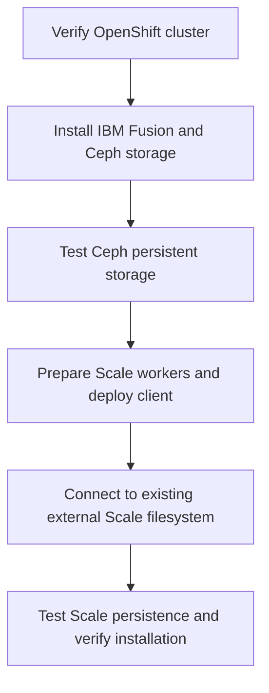

# IBM Fusion TechZone Automation

<!-- BEGIN DOCS V3.2 VALIDATION -->
**Latest Lab 1 validation (November 12, 2026):** The packaged v2.3 installer completed an end-to-end fresh-cluster Fusion/Ceph/external Scale storage test **after correcting an incorrect GUI password and resuming `scale-external`**. The initial run was not an uninterrupted success. See the [v2.3 validation record](docs/07-LIVE-VALIDATION-2026-11-12.md) and [Scale troubleshooting and recovery](docs/LAB01-SCALE-TROUBLESHOOTING.md). Installer code is unchanged by this documentation update.
<!-- END DOCS V3.2 VALIDATION -->

<!-- BEGIN V3.1 ONBOARDING -->
## New to Ansible? Start here first

**Starting from a Windows PC without an Ansible server?** Follow the [step-by-step getting started guide](docs/GETTING-STARTED-FROM-ZERO.md). It starts with an Ubuntu automation VM, installs Python/Ansible/OpenShift CLI, and walks through downloading the Lab 1 installer and connecting to IBM TechZone.

**Already have an Ubuntu Ansible control node?** Use the [Lab 1 installer instructions](README-START-HERE.md) directly.

**Installer ZIP:** use the packaged installer asset under [GitHub Releases](https://github.com/ryanbeaty-ibm/ibm-fusion-techzone-automation/releases). If no installer asset is published, the maintainer must [publish the package](docs/PUBLISH-RELEASE-ARCHIVE.md); **Code > Download ZIP** is a repository source archive, not necessarily the packaged installer.
<!-- END V3.1 ONBOARDING -->

**One-command Ansible automation for IBM Fusion Level 4 hands-on labs.**

This repository provides repeatable deployment and verification for the **IBM Fusion Level 4** training environment on **IBM Technology Zone (TechZone)**. The first supported workflow is **Lab 1 — Installation and Configuration**, covering IBM Fusion, Fusion Data Foundation / Ceph, and an IBM Storage Scale client attached to the lab's *already deployed* Scale server.

> **Lab environment only:** Designed for a disposable nine-node Red Hat OpenShift Container Platform (OCP) 4.21.x TechZone reservation. Not intended for production environments.

## Level 4 lab roadmap

| Lab | IBM Fusion Level 4 exercise | Automation |
|---|---|---|
| **1** | **[Installation and Configuration](docs/LAB01-INSTALLATION-AND-CONFIGURATION.md)** | **Available — Fusion, Ceph, and external Scale storage setup and verification** |
| 2 | Backup and Restore | Planned |
| 3 | OpenShift Virtualization | Planned |
| 4 | Control Tower | Planned |
| 5 | Regional Disaster Recovery | Planned |

**Official Lab 1 guide:** [IBM Fusion — Installation and Configuration (IBM Seismic)](https://ibm.seismic.com/Link/Content/DCCQJXbBM6f698WB3hmQ8mGmcp78). Access may require an authorized IBM or partner sign-in. Obtain the official workbook from IBM; it is **not redistributed** in this repository.

*Coverage note:* Lab 1 currently automates the **installation and persistent-storage portion** of the exercise, not every section of the workbook. Labs 2–5 are planned repository additions; no automation for them is included yet.

## Lab instructions

Each IBM Fusion Level 4 lab has its **own instructions page**. Select a lab from the roadmap above to open its guide.

**[Lab 1 — Installation and Configuration](docs/LAB01-INSTALLATION-AND-CONFIGURATION.md)** is available now. It contains the complete Quick Start: installer download and transfer, kubeconfig, lab parameters, the read-only `plan`, deployment, validation, and troubleshooting.

- **New to Ansible?** Begin with [Getting Started from Zero](docs/GETTING-STARTED-FROM-ZERO.md), including the [Hyper-V + Ubuntu prerequisites](docs/HYPERV-UBUNTU-PREREQUISITES.md).
- **Already have an Ubuntu Ansible control node?** Open the [Lab 1 instructions](docs/LAB01-INSTALLATION-AND-CONFIGURATION.md) directly.

Labs 2–5 are planned; their own guide links will be added as those labs become available.

## What Lab 1 automates

The workflow configures IBM Fusion Data Foundation, a three-node local Ceph storage cluster, and a three-node IBM Storage Scale data-access client. It connects to the predeployed Scale filesystem and creates the `fusionfs1` StorageClass. Both backends are tested for persistent data across pod replacement using SHA-256 verification.

## Documentation

[Start here](README-START-HERE.md) · [Prerequisites](docs/00-PREREQUISITES.md) · [Deployment runbook](docs/01-FRESH-LAB-RUNBOOK.md) · [Validation](docs/02-VALIDATION.md) · [Troubleshooting](docs/03-TROUBLESHOOTING.md) · [Live test results](docs/06-LIVE-VALIDATION-2026-11-11.md) · [Changelog](CHANGELOG.md) · [Security](SECURITY.md)

**Validation:** v2.2 completed all seven stages on a fresh TechZone reservation, including Ceph and Scale persistence tests. v2.3 adds installer-output and readiness improvements; it has passed offline checks but **has not yet been deployed end-to-end on a fresh reservation**. Consult the [validation report](docs/06-LIVE-VALIDATION-2026-11-11.md) for details and known limitations.

This is an **independent learning and community automation project**, not an official IBM-supported installer. Do not commit kubeconfigs, credentials, Vault keys, unredacted logs, or IBM-proprietary course content. Review the [publication checklist](docs/05-PRE-PUBLISH-CHECKLIST.md) before making the repository public.

## Hyper-V / Ubuntu automation VM prerequisites

For Windows Hyper-V setup and Ubuntu automation dependencies, see [Hyper-V + Ubuntu prerequisites](docs/HYPERV-UBUNTU-PREREQUISITES.md).
