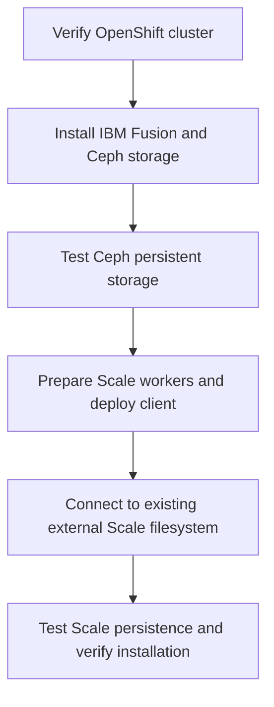

# IBM Fusion TechZone Automation

**One-command Ansible automation for IBM Fusion Level 4 hands-on labs.**

This repository provides repeatable deployment and verification for the **IBM Fusion Level 4** training environment on **IBM Technology Zone (TechZone)**. The first supported workflow is **Lab 1 — Installation and Configuration**, covering IBM Fusion, Fusion Data Foundation / Ceph, and an IBM Storage Scale client attached to the lab's *already deployed* Scale server.

> **Lab environment only:** Designed for a disposable nine-node Red Hat OpenShift Container Platform (OCP) 4.21.x TechZone reservation. Not intended for production environments.

## Level 4 lab roadmap

| Lab | IBM Fusion Level 4 exercise | Automation |
|---|---|---|
| **1** | **Installation and Configuration** | **Available — Fusion, Ceph, and external Scale storage setup and verification** |
| 2 | Backup and Restore | Planned |
| 3 | OpenShift Virtualization | Planned |
| 4 | Control Tower | Planned |
| 5 | Regional Disaster Recovery | Planned |

**Official Lab 1 guide:** [IBM Fusion — Installation and Configuration (IBM Seismic)](https://ibm.seismic.com/Link/Content/DCCQJXbBM6f698WB3hmQ8mGmcp78). Access may require an authorized IBM or partner sign-in. Obtain the official workbook from IBM; it is **not redistributed** in this repository.

*Coverage note:* Lab 1 currently automates the **installation and persistent-storage portion** of the exercise, not every section of the workbook. Labs 2–5 are planned repository additions; no automation for them is included yet.

## Quick start — Lab 1

**Prerequisites:** A fresh TechZone OCP 4.21.x reservation; a reachable Ubuntu host with Ansible and `oc`; the reservation's kubeconfig; an existing external Scale GUI endpoint and credentials; and a confirmed disposable disk on each of three infrastructure nodes. See [setup instructions](README-START-HERE.md) and [prerequisites](docs/00-PREREQUISITES.md).

1. Download your reservation's kubeconfig and store it **outside** the Git repository.
2. On the Ubuntu Ansible host, run the automatic, read-only plan:

```bash
bash install-lab01.sh plan \
  --cluster itz-REPLACE_ME \
  --kubeconfig "$HOME/.kube/newlab.conf" \
  --scale-host REPLACE_WITH_EXISTING_SCALE_IP \
  --ceph-disk /dev/vde
```

3. After confirming that `/dev/vde` (or your selected device) is an **empty disk intended for destruction on all three infrastructure nodes**, authorize the installation:

```bash
bash install-lab01.sh deploy \
  --cluster itz-REPLACE_ME \
  --kubeconfig "$HOME/.kube/newlab.conf" \
  --scale-host REPLACE_WITH_EXISTING_SCALE_IP \
  --ceph-disk /dev/vde \
  --claim-disks \
  --allow-worker-reboots
```

**Important:** `deploy` consumes the selected Ceph disks and may reboot worker nodes. All values shown above are examples: use the values from **your own** disposable reservation. The automation checks cluster health and storage prerequisites and stops on failure. The external Scale **server** must already exist; this installer does not build it.

## What Lab 1 automates



The workflow configures IBM Fusion Data Foundation, a three-node local Ceph storage cluster, and a three-node IBM Storage Scale data-access client. It connects to the predeployed Scale filesystem and creates the `fusionfs1` StorageClass. Both backends are tested for persistent data across pod replacement using SHA-256 verification.

## Documentation

[Start here](README-START-HERE.md) · [Prerequisites](docs/00-PREREQUISITES.md) · [Deployment runbook](docs/01-FRESH-LAB-RUNBOOK.md) · [Validation](docs/02-VALIDATION.md) · [Troubleshooting](docs/03-TROUBLESHOOTING.md) · [Live test results](docs/06-LIVE-VALIDATION-2026-11-11.md) · [Changelog](CHANGELOG.md) · [Security](SECURITY.md)

**Validation:** v2.2 completed all seven stages on a fresh TechZone reservation, including Ceph and Scale persistence tests. v2.3 adds installer-output and readiness improvements; it has passed offline checks but **has not yet been deployed end-to-end on a fresh reservation**. Consult the [validation report](docs/06-LIVE-VALIDATION-2026-11-11.md) for details and known limitations.

This is an **independent learning and community automation project**, not an official IBM-supported installer. Do not commit kubeconfigs, credentials, Vault keys, unredacted logs, or IBM-proprietary course content. Review the [publication checklist](docs/05-PRE-PUBLISH-CHECKLIST.md) before making the repository public.

## Hyper-V / Ubuntu automation VM prerequisites

For Windows Hyper-V setup and Ubuntu automation dependencies, see [Hyper-V + Ubuntu prerequisites](docs/HYPERV-UBUNTU-PREREQUISITES.md).
