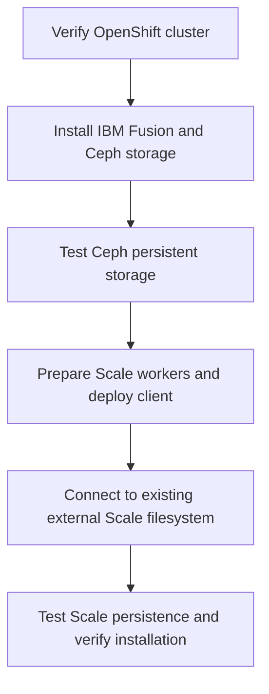

# IBM Fusion TechZone Automation

<!-- BEGIN DOCS V3.2 VALIDATION -->
**Latest Lab 1 validation (November 12, 2026):** The packaged v2.3 installer completed an end-to-end fresh-cluster Fusion/Ceph/external Scale storage test **after correcting an incorrect GUI password and resuming `scale-external`**. The initial run was not an uninterrupted success. See the [v2.3 validation record](docs/07-LIVE-VALIDATION-2026-11-12.md) and [Scale troubleshooting and recovery](docs/LAB01-SCALE-TROUBLESHOOTING.md). Installer code is unchanged by this documentation update.
<!-- END DOCS V3.2 VALIDATION -->


<!-- BEGIN V3.1 ONBOARDING -->
## New to Ansible? Start here first

**Starting from a Windows PC without an Ansible server?** Follow the [step-by-step getting started guide](docs/GETTING-STARTED-FROM-ZERO.md). It starts with an Ubuntu automation VM, installs Python/Ansible/OpenShift CLI, and walks through downloading the Lab 1 installer and connecting to IBM TechZone.

**Already have an Ubuntu Ansible control node?** Use the [Lab 1 installer instructions](README-START-HERE.md) directly.

**Installer ZIP:** use the packaged installer asset under [GitHub Releases](https://github.com/ryanbeaty-ibm/ibm-fusion-techzone-automation/releases). If no installer asset is published, the maintainer must [publish the package](docs/PUBLISH-RELEASE-ARCHIVE.md); **Code > Download ZIP** is a repository source archive, not necessarily the packaged installer.
<!-- END V3.1 ONBOARDING -->

**One-command Ansible automation for IBM Fusion Level 4 hands-on labs.**

This repository provides repeatable deployment and verification for the **IBM Fusion Level 4** training environment on **IBM Technology Zone (TechZone)**. The first supported workflow is **Lab 1 — Installation and Configuration**, covering IBM Fusion, Fusion Data Foundation / Ceph, and an IBM Storage Scale client attached to the lab's *already deployed* Scale server.

> **Lab environment only:** Designed for a disposable nine-node Red Hat OpenShift Container Platform (OCP) 4.21.x TechZone reservation. Not intended for production environments.

## Level 4 lab roadmap

| Lab | IBM Fusion Level 4 exercise | Automation |
|---|---|---|
| **1** | **[Installation and Configuration](README-START-HERE.md)** | **Available — Fusion, Ceph, and external Scale storage setup and verification** |
| 2 | Backup and Restore | Planned |
| 3 | OpenShift Virtualization | Planned |
| 4 | Control Tower | Planned |
| 5 | Regional Disaster Recovery | Planned |

**Official Lab 1 guide:** [IBM Fusion — Installation and Configuration (IBM Seismic)](https://ibm.seismic.com/Link/Content/DCCQJXbBM6f698WB3hmQ8mGmcp78). Access may require an authorized IBM or partner sign-in. Obtain the official workbook from IBM; it is **not redistributed** in this repository.

*Coverage note:* Lab 1 currently automates the **installation and persistent-storage portion** of the exercise, not every section of the workbook. Labs 2–5 are planned repository additions; no automation for them is included yet.

## Quick start — Lab 1 (existing Ansible control node)

**What this does:** The `plan` command **checks lab readiness without changing cluster resources**; the `deploy` command **runs the Ansible automation** to install and verify the supported IBM Fusion, Fusion Data Foundation/Ceph, and external IBM Storage Scale portions of Lab 1. A complete walkthrough is also available in [Start here — Lab 1 installer](README-START-HERE.md).

**Starting without an Ansible server?** Follow [Getting Started from Zero](docs/GETTING-STARTED-FROM-ZERO.md) first. The instructions below assume an Ubuntu automation host with Python, Ansible, OpenShift CLI (`oc`), SSH, and a current TechZone reservation. These instructions are for a **disposable lab, not production**.

### Step 1 — Download and install the Ansible scripts on Ubuntu

1. On your Windows PC, open [GitHub Releases](https://github.com/ryanbeaty-ibm/ibm-fusion-techzone-automation/releases). Open **IBM Fusion Lab 1 — Ansible Installer v2.3**.
2. Under **Assets**, download **`IBM-Fusion-Lab01-OneCommand-v2.3.zip`** to `C:\Users\YOUR_USERNAME\Downloads`. **Do not use** GitHub's automatically generated **Source code (zip)**; it is not the packaged installer asset.
3. Open a **SecureCRT Secure File Transfer Protocol (SFTP)** session to the Ubuntu VM. For the documented Ubuntu `automation` account, enter:

   ```text
   lcd C:\Users\YOUR_USERNAME\Downloads
   cd /home/automation
   put IBM-Fusion-Lab01-OneCommand-v2.3.zip
   ```

4. In your **Ubuntu SSH session**, extract and open the installer directory (run these in Ubuntu, not PowerShell):

   ```bash
   mkdir -p "$HOME/fusion-lab-v2.3"
   unzip -o "$HOME/IBM-Fusion-Lab01-OneCommand-v2.3.zip" -d "$HOME/fusion-lab-v2.3"
   cd "$HOME/fusion-lab-v2.3"
   ls -l install-lab01.sh
   ```

### Step 2 — Download and transfer your TechZone kubeconfig

1. Open your **TechZone reservation**.
2. Under **Download kubeconfig**, click **Download**.
3. Name the downloaded file for your lab, for example **`lab01.conf`**, and save it to `C:\Users\YOUR_USERNAME\Downloads`. Keep it **outside the Git repository**.
4. On Ubuntu, create a protected directory before transferring:

   ```bash
   mkdir -p "$HOME/.kube" && chmod 700 "$HOME/.kube"
   ```

5. In your **SecureCRT SFTP session**, run:

   ```text
   lcd C:\Users\YOUR_USERNAME\Downloads
   cd /home/automation/.kube
   put lab01.conf
   ```

6. Back in **Ubuntu SSH**, protect and test the file:

   ```bash
   chmod 600 "$HOME/.kube/lab01.conf"
   oc --kubeconfig="$HOME/.kube/lab01.conf" whoami --show-server
   oc --kubeconfig="$HOME/.kube/lab01.conf" get nodes
   ```

   Use your own filename in all subsequent commands. The output should identify the expected reservation's OpenShift Container Platform (OCP) API server.

### Step 3 — Obtain the lab values you will enter

1. In the TechZone reservation's **Outputs** section, record **Environment ID** (example `itz-REPLACE_ME`). This is `--cluster`.
2. Click **VM Remote Console**. Find the existing **`xxx-scale-2` / `xxx-scale-02`** virtual machine, and note its **IP Address**. This is `--scale-host` (the lab guide commonly shows `10.10.10.202`). The Scale VM is already deployed; the installer does **not** create it.
3. In the IBM Fusion Installation and Configuration lab guide, see labeled **pages 30 and 76** for the **IBM Storage Scale GUI / REST API username and password**. The installer normally suggests username `csi-storage-gui-user`. You will enter its matching password privately during deployment; **do not add it to a Git file**.
4. Confirm which unused **disposable** disk is assigned for Ceph on **each of the three infrastructure nodes**. The examples use `/dev/vde`; replace it if your reservation differs. `deploy` can erase the selected disks.

   **Need to log into the existing Scale Linux VM for troubleshooting?** Select the VM in **VM Remote Console**, click **Console** and use **RDP** with username `itzuser` and the **Bastion Password** from the reservation **Outputs**. This is **not** the Scale GUI password and `kubeadmin` is for OpenShift. See [Scale connectivity and credential troubleshooting](docs/LAB01-SCALE-TROUBLESHOOTING.md).

### Step 4 — Validate your lab (read-only preflight check)

Run from the extracted Ubuntu directory. **Replace the placeholders with your reservation's actual values**:

```bash
bash install-lab01.sh plan \
  --cluster itz-REPLACE_ME \
  --kubeconfig "$HOME/.kube/REPLACE_ME.conf" \
  --scale-host REPLACE_WITH_EXISTING_SCALE_IP \
  --ceph-disk /dev/vde
```

`REPLACE_ME.conf` is the filename you uploaded (for example, `lab01.conf`). The plan checks OCP version and health, ClusterOperators, MachineConfigPools, the selected target, and stage order. **It does not install anything or modify cluster resources.** Disk eligibility is checked immediately before Ceph claims during deployment; remote Scale GUI connectivity is checked later in the Scale connection stage. Confirm the displayed target before proceeding.

### Step 5 — Deploy Lab 1 (execute the Ansible automation)

**Warning: This command makes real cluster changes.** Confirm that the cluster is disposable and `/dev/vde` (or your selected disk) is intended to be erased on all three Ceph infrastructure nodes. The script may also reboot worker nodes.

```bash
bash install-lab01.sh deploy \
  --cluster itz-REPLACE_ME \
  --kubeconfig "$HOME/.kube/REPLACE_ME.conf" \
  --scale-host REPLACE_WITH_EXISTING_SCALE_IP \
  --ceph-disk /dev/vde \
  --claim-disks \
  --allow-worker-reboots
```

**Interactive Scale credentials (current v2.3 behavior):**

1. When prompted `Scale GUI username [csi-storage-gui-user]:`, press **Enter** to accept the shown default (or enter the assigned account).
2. When prompted `Scale GUI password (hidden):`, enter the matching password from the lab guide and press **Enter**. **Characters will not appear as you type**. The password is stored using Ansible Vault outside the repository. **v2.3 prompts only once**; double-entry confirmation and early authentication testing are planned installer improvements, not current features.

### Step 6 — Monitor and verify deployment

**Plan on roughly 40 minutes for a healthy environment**; timing varies and a failed authentication wait can add up to 30 minutes. Leave Ubuntu SSH connected, watch the Ansible stages, and do not interrupt long-running tasks merely because output pauses. The workflow runs `fusion-ceph`, `ceph-io-test`, `scale-nodeprep`, `scale-operator`, `scale-client`, `scale-external`, and `final-verification`.

A successful run ends with `PASS: ALL LAB 01 INSTALLATION AND STORAGE TEST STAGES.` This covers the supported **installation and persistent-storage** portion of Lab 1, not every workbook exercise. The Scale test also proves volume provisioning, write, remount, checksum, and cleanup.

**Recovery from a wrong Scale GUI password:** If only `scale-external` failed and the earlier stages passed, see [Scale troubleshooting and resume](docs/LAB01-SCALE-TROUBLESHOOTING.md). Do **not** reinstall Fusion or Ceph. The v2.3 resume command requires both authorization flags **even when resuming a later stage**.

**Validation status:** v2.3 passed on a fresh OCP 4.21.24 TechZone cluster on **November 12, 2026**, **after correcting a mistyped Scale GUI password and resuming from `scale-external`**. This was a validated recovery, **not** an uninterrupted first-attempt deployment. See [the v2.3 validation record](docs/07-LIVE-VALIDATION-2026-11-12.md) and [the original v2.2 validation record](VALIDATED-LAB01-RESULT.md).

## What Lab 1 automates



The workflow configures IBM Fusion Data Foundation, a three-node local Ceph storage cluster, and a three-node IBM Storage Scale data-access client. It connects to the predeployed Scale filesystem and creates the `fusionfs1` StorageClass. Both backends are tested for persistent data across pod replacement using SHA-256 verification.

## Documentation

[Start here](README-START-HERE.md) · [Prerequisites](docs/00-PREREQUISITES.md) · [Deployment runbook](docs/01-FRESH-LAB-RUNBOOK.md) · [Validation](docs/02-VALIDATION.md) · [Troubleshooting](docs/03-TROUBLESHOOTING.md) · [Live test results](docs/06-LIVE-VALIDATION-2026-11-11.md) · [Changelog](CHANGELOG.md) · [Security](SECURITY.md)

**Validation:** v2.2 completed all seven stages on a fresh TechZone reservation, including Ceph and Scale persistence tests. v2.3 adds installer-output and readiness improvements; it has passed offline checks but **has not yet been deployed end-to-end on a fresh reservation**. Consult the [validation report](docs/06-LIVE-VALIDATION-2026-11-11.md) for details and known limitations.

This is an **independent learning and community automation project**, not an official IBM-supported installer. Do not commit kubeconfigs, credentials, Vault keys, unredacted logs, or IBM-proprietary course content. Review the [publication checklist](docs/05-PRE-PUBLISH-CHECKLIST.md) before making the repository public.

## Hyper-V / Ubuntu automation VM prerequisites

For Windows Hyper-V setup and Ubuntu automation dependencies, see [Hyper-V + Ubuntu prerequisites](docs/HYPERV-UBUNTU-PREREQUISITES.md).
