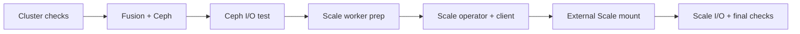

# IBM Fusion TechZone Automation

**One command to deploy and validate the storage portion of IBM Fusion Lab 01 on a fresh TechZone cluster.**

  

This independent project automates **IBM Storage Fusion**, **IBM Fusion Data Foundation / Ceph**, and an **IBM Storage Scale data-access client** connected to an **already deployed external Scale server**. Designed for a disposable nine-node IBM TechZone OpenShift Container Platform (OCP) 4.21 lab—not production.

> **Validation:** v2.2 completed all seven stages, including both persistent-storage tests, on a fresh cluster on **November 11, 2026**, in approximately **40 minutes**. v2.3 contains output/readiness improvements and has **not yet been tested end-to-end on another fresh reservation**. [See the observed results](docs/06-LIVE-VALIDATION-2026-11-11.md).

## At a glance

| | |
|---|---|
| **Inputs** | Named kubeconfig, TechZone cluster prefix, existing Scale management host, selected empty Ceph disks |
| **Target** | 3 control-plane + 3 infrastructure + 3 application workers, OCP 4.21.x |
| **Safety** | Exact API/identity pinning, automatic Ansible health gate, explicit disk/reboot authorization |
| **Output** | Working Fusion/Ceph + external Scale StorageClass, persistence tests and installation log |
| **Time** | ~40 minutes observed once; timing varies by reservation |

## Deployment path



## Get started

1. Follow the **[Windows / SecureCRT / Ubuntu quick start](README-START-HERE.md)** to transfer a named kubeconfig and prepare the Ubuntu Ansible host.
2. Review **[prerequisites and the destructive-operation boundaries](docs/00-PREREQUISITES.md)** before running any deployment.
3. Run `plan` with **your own** reservation values:

```bash
bash install-lab01.sh plan \
  --cluster itz-REPLACE_ME \
  --kubeconfig "$HOME/.kube/newlab.conf" \
  --scale-host REPLACE_WITH_EXISTING_SCALE_IP \
  --ceph-disk /dev/vde
```

When you have verified that the **same device path is a disposable, empty disk on each of the three infra nodes**, and approve worker reboots, execute:

```bash
bash install-lab01.sh deploy \
  --cluster itz-REPLACE_ME \
  --kubeconfig "$HOME/.kube/newlab.conf" \
  --scale-host REPLACE_WITH_EXISTING_SCALE_IP \
  --ceph-disk /dev/vde \
  --claim-disks \
  --allow-worker-reboots
```

**Warning:** `deploy` consumes the selected Ceph disks and may reboot three worker nodes. `/dev/vde` is an example, not a universally safe device. The installer is intentionally restricted to the specified disposable TechZone lab layout. Do not run on production or any cluster containing data you need to retain.

The initial deployment asks for an existing IBM Storage Scale GUI username/password and saves encrypted Ansible Vault variables **outside the repository** for later resume. The password is not passed on the command line.

## What gets deployed and tested

| Stage | Result |
|---|---|
| `fusion-ceph` | Fusion 2.14.1, Data Foundation service and 3 Ceph object storage daemons (OSDs) |
| `ceph-io-test` | PersistentVolumeClaim (PVC), 16 MiB write, pod replacement, SHA-256 verification |
| `scale-nodeprep` | Isolated three-node Scale MachineConfigPool, `kernel-devel` extension and expected reboots |
| `scale-operator` | Activate the IBM Storage Scale Operator and wait for a ready controller |
| `scale-client` | Three-node local Storage Scale data-access cluster |
| `scale-external` | Connect to the pre-deployed Scale server, mount `fs1`, create `fusionfs1`, test 16 MiB persistence |
| `final-verification` | Verify Fusion and Ceph health again |

The external Scale **server itself is not installed or rebuilt**. Remote cluster identity is discovered from the live environment rather than copied from an earlier reservation.

## Project layout

```text
install-lab01.sh               # Entry point
installer/                     # Guarded Python orchestrator + Ansible preflight
reference/                     # Proven source playbooks (historical pinned lab names)
       playbooks/ scripts/ templates/
work/<cluster>/                # Generated, private deployment workspace (Git-ignored)
tests/                         # Offline regression checks
.github/workflows/             # Automated source checks
docs/                          # Prerequisites, runbook, validation and security guidance
```

**Do not directly execute `reference/` playbooks.** They contain earlier TechZone cluster identities. The launcher compiles a pinned, cluster-specific workspace before using them.

## Documentation

[Quick start](README-START-HERE.md) · [Prerequisites](docs/00-PREREQUISITES.md) · [Deployment runbook](docs/01-FRESH-LAB-RUNBOOK.md) · [Validation](docs/02-VALIDATION.md) · [Troubleshooting](docs/03-TROUBLESHOOTING.md) · [Field-test evidence](docs/06-LIVE-VALIDATION-2026-11-11.md) · [Changelog](CHANGELOG.md) · [Security](SECURITY.md)

## Project boundaries

This is a **community/learning automation project**, not an official or supported IBM installer. It automates the installation and storage-validation portion of Lab 01, not every exercise in the IBM course. Product compatibility has been demonstrated only for the stated TechZone layout and versions. Do not publish kubeconfigs, credentials, Vault keys, unredacted logs, or proprietary course materials. A public release also requires reviewing all Git history and selecting a suitable license for original code; see the [publication checklist](docs/05-PRE-PUBLISH-CHECKLIST.md).
