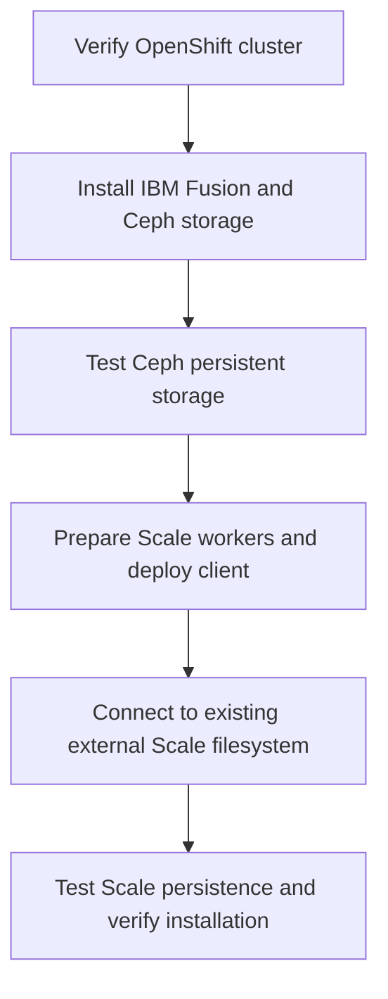

# Lab 1 — Installation and Configuration

[Project home](../README.md) · [Starting without Ansible?](GETTING-STARTED-FROM-ZERO.md) · [Scale troubleshooting and recovery](LAB01-SCALE-TROUBLESHOOTING.md)

This is the **complete, step-by-step Quick Start** for the supported IBM Fusion Level 4 Lab 1 installation and persistent-storage workflow. It assumes an existing Ubuntu Ansible control node; the first step also shows how to get the packaged installer onto it.

**What this does:** The `plan` command **checks lab readiness without changing cluster resources**; the `deploy` command **runs the Ansible automation** to install and verify the supported IBM Fusion, Fusion Data Foundation/Ceph, and external IBM Storage Scale portions of Lab 1. 

**Starting without an Ansible server?** Follow [Getting Started from Zero](GETTING-STARTED-FROM-ZERO.md) first. The instructions below assume an Ubuntu automation host with Python, Ansible, OpenShift CLI (`oc`), SSH, and a current TechZone reservation. These instructions are for a **disposable lab, not production**.

## What Lab 1 automates



The workflow configures IBM Fusion Data Foundation, a three-node local Ceph storage cluster, and a three-node IBM Storage Scale data-access client. It connects to the predeployed Scale filesystem and creates the `fusionfs1` StorageClass. Both backends are tested for persistent data across pod replacement using SHA-256 verification.

### Step 1 — Download and install the Ansible scripts on Ubuntu

1. On your Windows PC, open [GitHub Releases](https://github.com/ryanbeaty-ibm/ibm-fusion-techzone-automation/releases). Open **IBM Fusion Lab 1 — Ansible Installer v2.3**.
2. Under **Assets**, download **`IBM-Fusion-Lab01-OneCommand-v2.3.zip`** to `C:\Users\YOUR_USERNAME\Downloads`. **Do not use** GitHub's automatically generated **Source code (zip)**; it is not the packaged installer asset.
3. Open a **SecureCRT Secure File Transfer Protocol (SFTP)** session to the Ubuntu VM. For the documented Ubuntu `automation` account, enter:

   ```text
   lcd C:\Users\YOUR_USERNAME\Downloads
   cd /home/automation
   put IBM-Fusion-Lab01-OneCommand-v2.3.zip
   ```

4. In your **Ubuntu SSH session**, extract and open the installer directory (run these in Ubuntu, not PowerShell):

   ```bash
   mkdir -p "$HOME/fusion-lab-v2.3"
   unzip -o "$HOME/IBM-Fusion-Lab01-OneCommand-v2.3.zip" -d "$HOME/fusion-lab-v2.3"
   cd "$HOME/fusion-lab-v2.3"
   ls -l install-lab01.sh
   ```

### Step 2 — Download and transfer your TechZone kubeconfig

1. Open your **TechZone reservation**.
2. Under **Download kubeconfig**, click **Download**.
3. Name the downloaded file for your lab, for example **`lab01.conf`**, and save it to `C:\Users\YOUR_USERNAME\Downloads`. Keep it **outside the Git repository**.
4. On Ubuntu, create a protected directory before transferring:

   ```bash
   mkdir -p "$HOME/.kube" && chmod 700 "$HOME/.kube"
   ```

5. In your **SecureCRT SFTP session**, run:

   ```text
   lcd C:\Users\YOUR_USERNAME\Downloads
   cd /home/automation/.kube
   put lab01.conf
   ```

6. Back in **Ubuntu SSH**, protect and test the file:

   ```bash
   chmod 600 "$HOME/.kube/lab01.conf"
   oc --kubeconfig="$HOME/.kube/lab01.conf" whoami --show-server
   oc --kubeconfig="$HOME/.kube/lab01.conf" get nodes
   ```

   Use your own filename in all subsequent commands. The output should identify the expected reservation's OpenShift Container Platform (OCP) API server.

### Step 3 — Obtain the lab values you will enter

1. In the TechZone reservation's **Outputs** section, record **Environment ID** (example `itz-REPLACE_ME`). This is `--cluster`.
2. Click **VM Remote Console**. Find the existing **`xxx-scale-2` / `xxx-scale-02`** virtual machine, and note its **IP Address**. This is `--scale-host` (the lab guide commonly shows `10.10.10.202`). The Scale VM is already deployed; the installer does **not** create it.
3. In the IBM Fusion Installation and Configuration lab guide, see labeled **pages 30 and 76** for the **IBM Storage Scale GUI / REST API username and password**. The installer normally suggests username `csi-storage-gui-user`. You will enter its matching password privately during deployment; **do not add it to a Git file**.
4. Confirm which unused **disposable** disk is assigned for Ceph on **each of the three infrastructure nodes**. The examples use `/dev/vde`; replace it if your reservation differs. `deploy` can erase the selected disks.

   **Need to log into the existing Scale Linux VM for troubleshooting?** Select the VM in **VM Remote Console**, click **Console** and use **RDP** with username `itzuser` and the **Bastion Password** from the reservation **Outputs**. This is **not** the Scale GUI password and `kubeadmin` is for OpenShift. See [Scale connectivity and credential troubleshooting](LAB01-SCALE-TROUBLESHOOTING.md).

### Step 4 — Validate your lab (read-only preflight check)

Run from the extracted Ubuntu directory. **Replace the placeholders with your reservation's actual values**:

```bash
bash install-lab01.sh plan \
  --cluster itz-REPLACE_ME \
  --kubeconfig "$HOME/.kube/REPLACE_ME.conf" \
  --scale-host REPLACE_WITH_EXISTING_SCALE_IP \
  --ceph-disk /dev/vde
```

`REPLACE_ME.conf` is the filename you uploaded (for example, `lab01.conf`). The plan checks OCP version and health, ClusterOperators, MachineConfigPools, the selected target, and stage order. **It does not install anything or modify cluster resources.** Disk eligibility is checked immediately before Ceph claims during deployment; remote Scale GUI connectivity is checked later in the Scale connection stage. Confirm the displayed target before proceeding.

### Step 5 — Deploy Lab 1 (execute the Ansible automation)

**Warning: This command makes real cluster changes.** Confirm that the cluster is disposable and `/dev/vde` (or your selected disk) is intended to be erased on all three Ceph infrastructure nodes. The script may also reboot worker nodes.

```bash
bash install-lab01.sh deploy \
  --cluster itz-REPLACE_ME \
  --kubeconfig "$HOME/.kube/REPLACE_ME.conf" \
  --scale-host REPLACE_WITH_EXISTING_SCALE_IP \
  --ceph-disk /dev/vde \
  --claim-disks \
  --allow-worker-reboots
```

**Interactive Scale credentials (current v2.3 behavior):**

1. When prompted `Scale GUI username [csi-storage-gui-user]:`, press **Enter** to accept the shown default (or enter the assigned account).
2. When prompted `Scale GUI password (hidden):`, enter the matching password from the lab guide and press **Enter**. **Characters will not appear as you type**. The password is stored using Ansible Vault outside the repository. **v2.3 prompts only once**; double-entry confirmation and early authentication testing are planned installer improvements, not current features.

### Step 6 — Monitor and verify deployment

**Plan on roughly 40 minutes for a healthy environment**; timing varies and a failed authentication wait can add up to 30 minutes. Leave Ubuntu SSH connected, watch the Ansible stages, and do not interrupt long-running tasks merely because output pauses. The workflow runs `fusion-ceph`, `ceph-io-test`, `scale-nodeprep`, `scale-operator`, `scale-client`, `scale-external`, and `final-verification`.

A successful run ends with `PASS: ALL LAB 01 INSTALLATION AND STORAGE TEST STAGES.` This covers the supported **installation and persistent-storage** portion of Lab 1, not every workbook exercise. The Scale test also proves volume provisioning, write, remount, checksum, and cleanup.

**Recovery from a wrong Scale GUI password:** If only `scale-external` failed and the earlier stages passed, see [Scale troubleshooting and resume](LAB01-SCALE-TROUBLESHOOTING.md). Do **not** reinstall Fusion or Ceph. The v2.3 resume command requires both authorization flags **even when resuming a later stage**.

**Validation status:** v2.3 passed on a fresh OCP 4.21.24 TechZone cluster on **November 12, 2026**, **after correcting a mistyped Scale GUI password and resuming from `scale-external`**. This was a validated recovery, **not** an uninterrupted first-attempt deployment. See [the v2.3 validation record](07-LIVE-VALIDATION-2026-11-12.md) and [the original v2.2 validation record](../VALIDATED-LAB01-RESULT.md).
