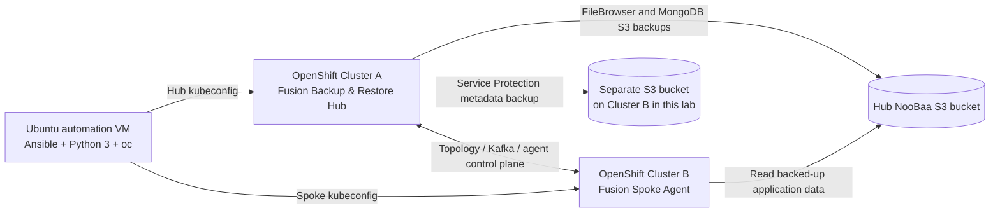

# IBM Fusion Level 4 — Lab 02: Backup & Restore automation

> **START HERE — Two independent IBM Fusion / OpenShift clusters are required for the *full* lab.**
>
> For IBM TechZone, normally make **TWO separate Fusion environment reservations before starting** (one hub and one spoke), and keep both active until cross-cluster recovery is finished. If you already have two eligible clusters, you may reuse them. **You do not need to complete Lab 01 first.** The first application backup/restore sections need only one cluster; the hub-and-spoke and cross-cluster sections need two.

This repository consolidates our IBM Fusion Level 4 Lab 02 test implementation: **IBM Fusion Backup & Restore hub provisioning, NooBaa S3 configuration, FileBrowser recovery, MongoDB application-consistent recovery, Service Protection, spoke onboarding, and cross-cluster recovery**. It preserves the actual operational ordering and distinguishes automation from the supported IBM Fusion graphical-interface (GUI) checkpoints.

**Validated example:** OpenShift Container Platform (OCP) **4.21.24**, IBM Fusion **2.14.1**, November 12–13, 2026. The provided original lab guide was written for an earlier Fusion release; validate custom resource schemas and UI labels for the version you use. This is training lab automation, **not a production disaster recovery guarantee**.

## 1. Architecture and prerequisites



**Before starting**, prepare both TechZone reservations or equivalent clusters, administrative kubeconfigs, working DNS and required routes between clusters, compatible Fusion versions, appropriate StorageClasses, the VolumeSnapshotClass, and an Ubuntu VM with:

- Ubuntu Linux, Python 3, Ansible (`ansible-playbook`), OpenShift CLI (`oc`), OpenSSL, `curl`, `unzip`, and Bash.
- `~/.kube/lab02.conf` for the **hub** and `~/.kube/lab01.conf` for the **spoke** in our example; adjust to your file locations.
- Hub RBD StorageClass `ocs-storagecluster-ceph-rbd`, snapshot class `ocs-storagecluster-rbdplugin-snapclass`, and NooBaa OBC StorageClass `openshift-storage.noobaa.io`.
- Spoke StorageClass `ocs-storagecluster-ceph-rbd` with snapshot support, and storage for the Backup & Restore spoke agent (Fusion UI cited at least 34 GiB ReadWriteOnce).
- Spoke-to-hub networking for IBM Fusion/Kafka plus spoke access to the **hub S3 endpoint** for cross-cluster application recovery; test these paths, not merely the automation VM's network.
- Separate, appropriately resilient S3-compatible object storage for **Service Protection**. In this lab we used a dedicated NooBaa bucket on the second cluster; for production choose independently operated durable object storage.

Read [prerequisites and environment setup](docs/prerequisites.md) for example Ubuntu installation commands, namespace requirements and permission boundaries.

## 2. Configure your own two reservations

The supplied playbooks preserve working resource names from the validated example. **Do not run them with an unreviewed kubeconfig or unedited cluster identities.**

On the Ubuntu automation VM, from this `lab02` directory:

```bash
cp config/environment.example.yml config/environment.yml
chmod 600 config/environment.yml
# Edit config/environment.yml with YOUR hub and spoke API hosts, kubeconfig paths, and registered spoke name.
# Example: nano config/environment.yml
```

`config/environment.yml` is `.gitignore`d. Only non-sensitive public hostnames and kubeconfig **paths** go here; do not put passwords or tokens in it. For the example environment, the hub is `itz-t63twk` and the spoke is `itz-2xvmb0`. The cluster identity assertions reject unexpected targets.

A managed environment may use different StorageClass names or Fusion custom resource fields. If you change those, examine the bundled application manifests and each playbook before running; the example assumes Ceph RBD and NooBaa. The first v0.1–v0.4.4 versions use fixed demonstration names such as `filebrowser` and `pacman`; choose fresh, lab-owned namespaces and backup names if you are not starting from a clean reservation.

## 3. Run the complete Lab 02 with ONE command

From Ubuntu, after configuring `config/environment.yml` (section 2), run:

```bash
bash scripts/run-lab02.sh
```

**That is the normal entry point.** It automatically executes stages **01–04** in sequence, automatically prepares the stage **05a** Service Protection bucket and certificate, **pauses for only two IBM Fusion UI tasks** (05b and 06a), automatically checks prerequisites (05c), deploys the spoke agent (06b) and performs cross-cluster restore plus SHA-256 validation (07). Type `CONTINUE` at each UI checkpoint **only after verifying the required status**. The 05c preflight checks the bucket/cert/network, **not** the Service Protection backup job itself; the latter is verified in the Fusion UI.

To review the execution plan without doing anything:

```bash
bash scripts/run-lab02.sh --plan
```

If a stage fails, fix the cause and resume without rerunning earlier stages, for example `bash scripts/run-lab02.sh --from 05c` or `bash scripts/run-lab02.sh --from 07`. The wrapper stops immediately on errors; it never skips a failing stage automatically. The underlying playbooks are separate **implementation modules**, not separate commands a normal user must run.

### Internal stages (run automatically unless marked manual)

| Stage | Action | How to run | Evidence / outcome |
|---|---|---|---|
| **01** | Install IBM Fusion Backup & Restore hub | **Automatic** | Fusion service instance `Completed` |
| **02** | Create hub NooBaa OBC, S3 location, snapshot and weekly backup policies | **Automatic** | `hubspoke-bucket` `Connected` |
| **03** | Deploy FileBrowser; backup and restore into `filebrowser2`; verify 8 MiB SHA-256 | **Automatic** | Backup/Restore `Completed`, matching hashes |
| **04** | MongoDB/Pac-Man application-consistent backup, `pacman4` recovery, automatic UID repair | **Automatic** | `fsyncLock`/`fsyncUnlock` and MongoDB document hash passed |
| **05a** | **AUTO** — prepare second-cluster Service Protection bucket and hub certificate | Run by `run-lab02.sh` | Dedicated OBC `Bound`; certificate Secret created |
| **05b** | **MANUAL GUI** — configure Service Protection storage and daily schedule; initiate backup | IBM Fusion Hub **Backup & restore → Service protection** | Storage location `Connected`; first service backup `Completed` |
| **05c** | **AUTO** — read-only preflight of Service Protection storage prerequisites | Run by `run-lab02.sh` | OBC and certificate exist; S3 endpoint responds |
| **06a** | **MANUAL GUI** — generate one-hour spoke installation YAML from Hub Topology | IBM Fusion Hub **Topology → Connect clusters → Automate deployment** | Local `BackupAndRestoreAgentDeployment.yaml`, **never commit** |
| **06b** | **AUTO** — bootstrap spoke from hub-generated YAML | Run by `run-lab02.sh` | Agent instance `Completed`, Topology `Connected/Healthy` |
| **07** | Restore FileBrowser to the spoke, verify source/spoke SHA-256, reuse on rerun | **Automatic** | Cross-cluster integrity passed; `changed=0` on validated adoption run |

**Important:** stages 01–04 and 07 use existing validated playbook bodies, with small consolidation changes (overridable cluster guards and final fixes). Stage 05a/05c and the Ansible wrapper stage 06b are *new helpers, statically checked but not live-tested*. The **manual** OBC/certificate setup and hub-generated YAML deployment commands **were live validated**. Stage 02 was functionally validated; some `oc apply` operations can still report changes on a rerun. Stage 07's Ansible adoption/read-only verification succeeded, but its fresh-restore creation branch was not separately live-tested (the first restore was initiated using `oc`). See [validation evidence](evidence/validated-runs.md).

### Manual checkpoints — only two

**05b — Service Protection:** Hub IBM Fusion GUI → **Backup & restore → Service protection**. Configure the pre-created S3 bucket/certificate, daily schedule, and initiate a backup. Confirm the first backup is **Completed** before typing `CONTINUE` in Ubuntu.

**06a — Connect spoke:** Hub IBM Fusion GUI → **Backup & restore → Topology → Connect cluster → Automate deployment**. Generate/download `BackupAndRestoreAgentDeployment.yaml`, transfer it securely into your Ubuntu home folder and set `chmod 600`. Then type `CONTINUE`; Ansible will apply it to the spoke and validate readiness. If already connected and healthy, this step does not require another YAML.

See [step-by-step UI checkpoints](docs/manual-checkpoints.md). These are the only two normal pauses. The detailed playbook commands are reserved for [advanced stage troubleshooting](docs/advanced-operations.md).

## 4. Repository contents

```text
lab02/
  README.md
  .gitignore
  config/environment.example.yml   # copy to ignored environment.yml
  installer/
    01-backup-restore-hub.yml
    02-noobaa-s3-and-policies.yml
    03-filebrowser-backup-restore.yml
    filebrowser-all-v0.3.yaml
    04-mongodb-consistent-backup-restore.yml
    mongodb-recipe-v0.4.yaml
    pacman-all-v0.4.yaml
    05-service-protection-prepare.yml
    05-service-protection-preflight.yml
    06-spoke-agent-bootstrap.yml
    07-crosscluster-filebrowser-restore.yml
  docs/advanced-operations.md
  docs/prerequisites.md
  docs/manual-checkpoints.md
  docs/security.md
  docs/troubleshooting.md
  evidence/validated-runs.md
  scripts/run-lab02.sh              # THE ONLY COMMAND FOR NORMAL EXECUTION
  scripts/run-stage.sh               # advanced per-stage troubleshooting
```

## 5. Safety and limitations

- **Lab-only:** sample MongoDB allows empty passwords; do not reuse this insecure configuration in production.
- Never commit OBC keys, kubeconfigs, certificates/private keys, generated spoke YAML, `oc` token outputs or screenshots that reveal credentials.
- Restore tests intentionally **do not delete** completed backups, restored namespaces, or application data. Use unique resource names for fresh reruns; do not delete successful recoveries simply to force a new job.
- MongoDB alternate-namespace recovery may require a temporary, namespace-scoped `anyuid` Security Context Constraint grant for file ownership repair. The playbook attempts cleanup even on failure; inspect access manually if interrupted. It must not touch the source PVC.
- Service Protection can be configured in the IBM Fusion UI; the successful service backup is not a tested full recovery of the service control plane.
- Data verification uses SHA-256 integrity of test data and document content, not full application behavior or disaster recovery RTO/RPO guarantees.
- No unpublished credential-bearing YAML, screenshots, reservation-specific data or IBM proprietary PDF guide are bundled in this repository.

## 6. GitHub installation

The ZIP contains only `lab02/` and can be extracted over the same folder in the existing local Git repository without modifying Lab 01 or the root README. On Windows, use `Expand-Archive -Force` to overlay the files; see [GitHub publication steps](docs/publish-to-github.md). Review the diff in GitHub Desktop before committing and pushing. The owner should choose licensing before making the repository public.

For original IBM procedural context, use your authorized **IBM Fusion Level 4 Backup and Restore Lab Guide**, and check IBM documentation for your installed Fusion version. Our README documents the tested 2.14.1 implementation and known differences from the older guide.
