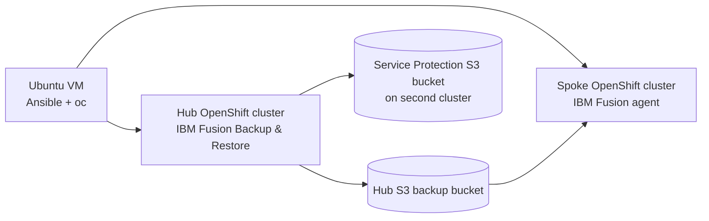

# IBM Fusion Level 4 — Lab 02: Backup and Restore

**Automate IBM Fusion Backup & Restore with Ansible, then prove application recovery on a second OpenShift cluster.**

> **New to Lab 02? Start with the [step-by-step installation and lab guide](docs/LAB02-BACKUP-AND-RESTORE.md).** It starts with two TechZone reservations and an Ubuntu VM, includes copy/paste commands and screenshots-independent Fusion UI directions, and ends with a verified restore. You do **not** need to complete Lab 01 first.

## What you will build

The complete lab needs **two independent IBM Fusion / Red Hat OpenShift Container Platform (OCP) clusters running at the same time**:

| Role | What it does | Required |
|---|---|---|
| **Hub** | Runs IBM Fusion Backup & Restore, creates S3 backups and controls restores | Yes |
| **Spoke** | Receives the Fusion backup agent and recovered FileBrowser application | Yes for full lab |
| **Ubuntu automation VM** | Runs Ansible and the `oc` OpenShift command-line client against both clusters | Yes |

For IBM TechZone, reserve **two environments** (or reuse a compatible existing second cluster). Don't install the full Backup & Restore hub service on the spoke. The first four stages work on the hub; the later cross-cluster work requires the spoke.



## Start here — quick path

These are the **only normal terminal commands** after you have obtained two administrator kubeconfigs and installed the tools in the [full guide](docs/LAB02-BACKUP-AND-RESTORE.md).

**1. Get the repository on your Ubuntu automation VM:**

```bash
git clone https://github.com/ryanbeaty-ibm/ibm-fusion-techzone-automation.git
cd ibm-fusion-techzone-automation/lab02
```

**2. Configure your environment:**

```bash
cp config/environment.example.yml config/environment.yml
chmod 600 config/environment.yml
nano config/environment.yml
```

Provide the two kubeconfig paths, the actual hub and spoke API hostnames, hub and spoke S3 routes, and spoke apps domain. The example file contains our **old TechZone validation values**; **replace them with your own reservations**. Never commit kubeconfigs, tokens, access keys, or the generated spoke installation YAML.

**3. Review the plan, then run the whole lab:**

```bash
bash scripts/run-lab02.sh --plan
bash scripts/run-lab02.sh
```

The script runs stages 01–04, prepares Service Protection storage, **pauses at two IBM Fusion UI checkpoints**, then installs the spoke agent and verifies cross-cluster data integrity. The separate Ansible files under `installer/` are internal modules, **not separate commands you must run**.

## The two times you'll use IBM Fusion's web interface

**Checkpoint 1 — Configure Service Protection (05b).** The script prepares a dedicated bucket on the second cluster and its certificate Secret automatically. In the **hub** Fusion UI, go to **Backup & restore → Service protection**, configure the S3 Compliant location and daily policy, select *Initiate service backup now*, and confirm the first backup says **Completed**. Return to Ubuntu and type `CONTINUE`.

**Checkpoint 2 — Generate the spoke connection YAML (06a).** In the **hub** Fusion UI, go to **Backup & restore → Topology → Connect cluster → Automate deployment**, enter the spoke StorageClass, generate and download `BackupAndRestoreAgentDeployment.yaml`. Securely transfer it to `~/BackupAndRestoreAgentDeployment.yaml` on Ubuntu, set permission `600`, then type `CONTINUE`. Ansible applies it to the **spoke**, waits for a healthy connection and performs the cross-cluster restore. **The generated YAML contains a short-lived secret; never commit it.**

The [full walkthrough](docs/LAB02-BACKUP-AND-RESTORE.md) describes every click and verification. If your spoke was already connected and healthy, you don't need to generate another manifest.

## What success looks like

The script should finish with `LAB 02 COMPLETE`. In IBM Fusion's **hub Topology**, the second cluster must show **Connected / Healthy**. On the spoke, the restored FileBrowser deployment must be ready and both Persistent Volume Claims (PVCs) bound. The original 8 MiB test file and recovered file must have matching **SHA-256** hashes.

Our **November 12–13, 2026** TechZone validation used OCP **4.21.24** / IBM Fusion **2.14.1**. Its cross-cluster FileBrowser data matched and the v0.7 Ansible adoption verification returned **`ok=21 changed=0 failed=0`**. These results are evidence for that environment, not a guarantee for another reservation. The newly added single-command wrapper and automated Service Protection preparation have been statically checked **but not yet live-tested end-to-end**. See [validated evidence](evidence/validated-runs.md).

## If the script stops

Fix the issue it reports; you **do not** need to rerun every prior stage. Resume from the appropriate checkpoint, for example:

```bash
bash scripts/run-lab02.sh --from 05b
# Or, after the spoke is connected:
bash scripts/run-lab02.sh --from 07
```

Use the [troubleshooting guide](docs/troubleshooting.md) and [advanced stage operations](docs/advanced-operations.md) only when needed. The runner stops on errors; it does not silently skip failing stages.

## Reference documentation

- **[Step-by-step Lab 02 installation and lab guide](docs/LAB02-BACKUP-AND-RESTORE.md)** — beginner-friendly instructions, commands, click paths, verification, recovery
- [Prerequisites and Ubuntu setup](docs/prerequisites.md) — further requirements, storage and permissions
- [Detailed manual Fusion UI checkpoints](docs/manual-checkpoints.md) — Service Protection and spoke connection
- [Advanced Ansible stages](docs/advanced-operations.md) — troubleshooting individual playbooks
- [Validated test results](evidence/validated-runs.md) — actual observed outcomes and limitations
- [Security guidance](docs/security.md) — credentials and secret-file handling
- [GitHub publishing](docs/publish-to-github.md) — keeping Lab 01 intact

> **Scope:** This is a training-lab implementation, not a production disaster-recovery design. Service Protection was successfully backed up, but no full service-control-plane restore was tested. The example MongoDB deployment uses lab-only, insecure credentials. The proprietary IBM lab workbook is not redistributed here.
