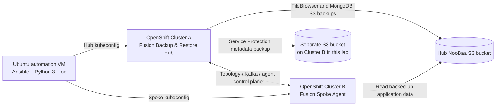

# IBM Fusion Level 4 — Lab 02: Backup & Restore automation

> **START HERE — Two independent IBM Fusion / OpenShift clusters are required for the *full* lab.**
>
> For IBM TechZone, normally make **TWO separate Fusion environment reservations before starting** (one hub and one spoke), and keep both active until cross-cluster recovery is finished. If you already have two eligible clusters, you may reuse them. **You do not need to complete Lab 01 first.** The first application backup/restore sections need only one cluster; the hub-and-spoke and cross-cluster sections need two.

This repository consolidates our IBM Fusion Level 4 Lab 02 test implementation: **IBM Fusion Backup & Restore hub provisioning, NooBaa S3 configuration, FileBrowser recovery, MongoDB application-consistent recovery, Service Protection, spoke onboarding, and cross-cluster recovery**. It preserves the actual operational ordering and distinguishes automation from the supported IBM Fusion graphical-interface (GUI) checkpoints.

**Validated example:** OpenShift Container Platform (OCP) **4.21.24**, IBM Fusion **2.14.1**, November 12–13, 2026. The provided original lab guide was written for an earlier Fusion release; validate custom resource schemas and UI labels for the version you use. This is training lab automation, **not a production disaster recovery guarantee**.

## 1. Architecture and prerequisites



**Before starting**, prepare both TechZone reservations or equivalent clusters, administrative kubeconfigs, working DNS and required routes between clusters, compatible Fusion versions, appropriate StorageClasses, the VolumeSnapshotClass, and an Ubuntu VM with:

- Ubuntu Linux, Python 3, Ansible (`ansible-playbook`), OpenShift CLI (`oc`), OpenSSL, `curl`, `unzip`, and Bash.
- `~/.kube/lab02.conf` for the **hub** and `~/.kube/lab01.conf` for the **spoke** in our example; adjust to your file locations.
- Hub RBD StorageClass `ocs-storagecluster-ceph-rbd`, snapshot class `ocs-storagecluster-rbdplugin-snapclass`, and NooBaa OBC StorageClass `openshift-storage.noobaa.io`.
- Spoke StorageClass `ocs-storagecluster-ceph-rbd` with snapshot support, and storage for the Backup & Restore spoke agent (Fusion UI cited at least 34 GiB ReadWriteOnce).
- Spoke-to-hub networking for IBM Fusion/Kafka plus spoke access to the **hub S3 endpoint** for cross-cluster application recovery; test these paths, not merely the automation VM's network.
- Separate, appropriately resilient S3-compatible object storage for **Service Protection**. In this lab we used a dedicated NooBaa bucket on the second cluster; for production choose independently operated durable object storage.

Read [prerequisites and environment setup](docs/prerequisites.md) for example Ubuntu installation commands, namespace requirements and permission boundaries.

## 2. Configure your own two reservations

The supplied playbooks preserve working resource names from the validated example. **Do not run them with an unreviewed kubeconfig or unedited cluster identities.**

On the Ubuntu automation VM, from this `lab02` directory:

```bash
cp config/environment.example.yml config/environment.yml
chmod 600 config/environment.yml
# Edit config/environment.yml with YOUR hub and spoke API hosts, kubeconfig paths, and registered spoke name.
# Example: nano config/environment.yml
```

`config/environment.yml` is `.gitignore`d. Only non-sensitive public hostnames and kubeconfig **paths** go here; do not put passwords or tokens in it. For the example environment, the hub is `itz-t63twk` and the spoke is `itz-2xvmb0`. The cluster identity assertions reject unexpected targets.

A managed environment may use different StorageClass names or Fusion custom resource fields. If you change those, examine the bundled application manifests and each playbook before running; the example assumes Ceph RBD and NooBaa. The first v0.1–v0.4.4 versions use fixed demonstration names such as `filebrowser` and `pacman`; choose fresh, lab-owned namespaces and backup names if you are not starting from a clean reservation.

## 3. Execution order — automated stages and manual checkpoints

| Stage | Action | How to run | Evidence / outcome |
|---|---|---|---|
| **01** | Install IBM Fusion Backup & Restore hub | `./scripts/run-stage.sh 01 run` | Fusion service instance `Completed` |
| **02** | Create hub NooBaa OBC, S3 location, snapshot and weekly backup policies | `./scripts/run-stage.sh 02 run` | `hubspoke-bucket` `Connected` |
| **03** | Deploy FileBrowser; backup and restore into `filebrowser2`; verify 8 MiB SHA-256 | `./scripts/run-stage.sh 03 run` | Backup/Restore `Completed`, matching hashes |
| **04** | MongoDB/Pac-Man application-consistent backup, `pacman4` recovery, automatic UID repair | `./scripts/run-stage.sh 04 run` | `fsyncLock`/`fsyncUnlock` and MongoDB document hash passed |
| **05a** | Prepare second-cluster Service Protection bucket and hub certificate | Follow [manual checkpoints](docs/manual-checkpoints.md) | Dedicated OBC `Bound`, reachable S3, certificate Secret created |
| **05b** | **GUI** — configure Service Protection storage and daily schedule; initiate backup | IBM Fusion Hub **Backup & restore → Service protection** | Storage location `Connected`; first service backup `Completed` |
| **05c** | Read-only preflight of Service Protection storage prerequisites | See below | OBC and certificate exist; S3 endpoint responds |
| **06a** | **GUI** — generate one-hour spoke installation YAML from Hub Topology | IBM Fusion Hub **Topology → Connect clusters → Automate deployment** | Local `BackupAndRestoreAgentDeployment.yaml`, **never commit** |
| **06b** | Bootstrap spoke on second cluster using hub-generated YAML | See below, or validated `oc --kubeconfig=... apply -f` | Agent instance `Completed`, Topology `Connected/Healthy` |
| **07** | Restore FileBrowser to the spoke, verify source/spoke SHA-256, reuse on rerun | `./scripts/run-stage.sh 07 run` | Cross-cluster integrity passed; `changed=0` on validated adoption run |

**Important:** stages 01–04 and 07 use existing validated playbook bodies, with small consolidation changes (overridable cluster guards and final fixes). Stage 05c and Ansible wrapper stage 06b are *new helpers, statically checked but not live-tested*. The **manual** OBC/certificate setup and hub-generated YAML deployment commands **were live validated**. Stage 02 was functionally validated; some `oc apply` operations can still report changes on a rerun. Stage 07's Ansible adoption/read-only verification succeeded, but its fresh-restore creation branch was not separately live-tested (the first restore was initiated using `oc`). See [validation evidence](evidence/validated-runs.md).

### Commands for Ansible stages

Use the stage runner to keep config and playbook consistent:

```bash
./scripts/run-stage.sh 01 syntax
./scripts/run-stage.sh 01 check
./scripts/run-stage.sh 01 run

./scripts/run-stage.sh 02 check
./scripts/run-stage.sh 02 run
./scripts/run-stage.sh 03 run
./scripts/run-stage.sh 04 run
```

Wait for each stage to complete and inspect its results before starting the next. `--check` runs preflight on the application playbooks and **intentionally skips backup/restore and hash proof**. Execute normally to prove data integrity. Most polling intervals are 15 seconds; 30-minute waits are upper bounds, not delays.

### Service Protection manual interlude (05)

Follow [docs/manual-checkpoints.md](docs/manual-checkpoints.md) for a dedicated OBC on the second cluster, TLS certificate handling, exact Fusion UI fields and schedule. Then run this *read-only* prerequisite verifier:

```bash
ansible-playbook -i localhost, -c local installer/05-service-protection-preflight.yml \
  -e @config/environment.yml
```

This confirms storage inputs, **not** that IBM Fusion created a successful service backup. Verify status and available backup count in the Fusion UI; do not claim end-to-end automation of this UI-only feature.

### Spoke bootstrap manual interlude (06)

From the **hub UI**, download the IBM-generated `BackupAndRestoreAgentDeployment.yaml`, copy it onto Ubuntu, and set `chmod 600`. Deploy only to the spoke. We originally validated the explicit `oc --kubeconfig="$HOME/.kube/lab01.conf" apply -f ...` command. An optional Ansible wrapper for future runs:

```bash
ansible-playbook -i localhost, -c local installer/06-spoke-agent-bootstrap.yml \
  -e @config/environment.yml \
  -e "generated_spoke_manifest=$HOME/BackupAndRestoreAgentDeployment.yaml"
```

**Do not use the generated YAML after its token expires (~1 hour).** Never commit or paste the generated file. Confirm the **hub UI Topology** displays the second cluster `Connected / Healthy`.

### Cross-cluster application restore (07)

After the hub has a successful FileBrowser S3 backup, the spoke agent is connected, the spoke can reach the hub S3 route, and its destination `filebrowser` namespace is free (or owned by the matching restore):

```bash
./scripts/run-stage.sh 07 syntax
./scripts/run-stage.sh 07 check
./scripts/run-stage.sh 07 run
# Repeat the exact same command to confirm idempotency.
./scripts/run-stage.sh 07 run
```

The Restore custom resource is created **on the hub** using the registered spoke's `targetCluster`. The playbook refuses to overwrite a namespace on the spoke if the matching managed restore is absent, and refuses conflicting Restore objects. It then verifies the source and recovered SHA-256 hashes. See [validation evidence](evidence/validated-runs.md).

## 4. Repository contents

```text
lab02/
  README.md
  .gitignore
  config/environment.example.yml   # copy to ignored environment.yml
  installer/
    01-backup-restore-hub.yml
    02-noobaa-s3-and-policies.yml
    03-filebrowser-backup-restore.yml
    filebrowser-all-v0.3.yaml
    04-mongodb-consistent-backup-restore.yml
    mongodb-recipe-v0.4.yaml
    pacman-all-v0.4.yaml
    05-service-protection-preflight.yml
    06-spoke-agent-bootstrap.yml
    07-crosscluster-filebrowser-restore.yml
  docs/prerequisites.md
  docs/manual-checkpoints.md
  docs/security.md
  docs/troubleshooting.md
  evidence/validated-runs.md
  scripts/run-stage.sh
```

## 5. Safety and limitations

- **Lab-only:** sample MongoDB allows empty passwords; do not reuse this insecure configuration in production.
- Never commit OBC keys, kubeconfigs, certificates/private keys, generated spoke YAML, `oc` token outputs or screenshots that reveal credentials.
- Restore tests intentionally **do not delete** completed backups, restored namespaces, or application data. Use unique resource names for fresh reruns; do not delete successful recoveries simply to force a new job.
- MongoDB alternate-namespace recovery may require a temporary, namespace-scoped `anyuid` Security Context Constraint grant for file ownership repair. The playbook attempts cleanup even on failure; inspect access manually if interrupted. It must not touch the source PVC.
- Service Protection can be configured in the IBM Fusion UI; the successful service backup is not a tested full recovery of the service control plane.
- Data verification uses SHA-256 integrity of test data and document content, not full application behavior or disaster recovery RTO/RPO guarantees.
- No unpublished credential-bearing YAML, screenshots, reservation-specific data or IBM proprietary PDF guide are bundled in this repository.

## 6. GitHub installation

This package is designed to be extracted **as `lab02/` inside your existing Git repository**, alongside `lab01/` if present. Do not overwrite your validated Lab 01 files. See [GitHub publication steps](docs/publish-to-github.md). The owner should choose licensing before making the repository public.

On the validated Windows workstation, the existing Git clone is `D:\GitHub\ibm-fusion-techzone-automation`. Use the supplied standalone `Apply-IBM-Fusion-Lab02-GitHub.ps1` (downloaded alongside this ZIP) to stage changes outside Git and copy only `lab02/`, then use GitHub Desktop to review, commit and Push origin.

For original IBM procedural context, use your authorized **IBM Fusion Level 4 Backup and Restore Lab Guide**, and check IBM documentation for your installed Fusion version. Our README documents the tested 2.14.1 implementation and known differences from the older guide.
